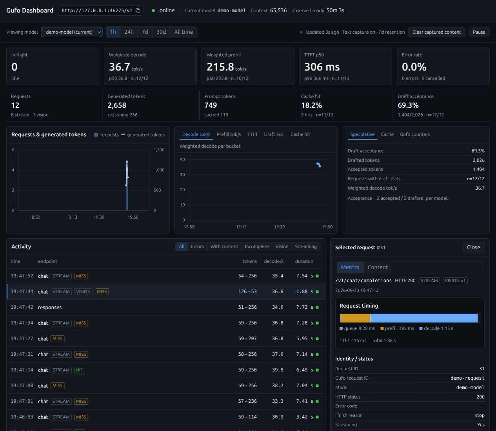
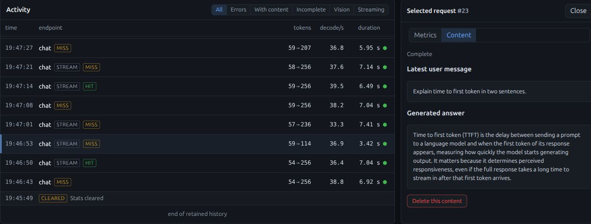

# Gufo Dashboard

A local statistics dashboard and HTTP, SSE, and WebSocket proxy for Gufo
inference servers. Route clients through the dashboard to track token usage,
throughput, latency, cache hits, and speculative decoding over time.



*Real measurements from 12 controlled demo requests. Model and upstream request
identifiers are anonymized; these figures illustrate the interface, not a benchmark.*

## What it does

- Tracks requests across Chat Completions, Completions, Responses, Messages, and
  Gufo's native `/completion` endpoint.
- Proxies HTTP responses, SSE streams, and bidirectional WebSocket messages
  (including text and binary audio).
- Shows live in-flight requests, recent activity, errors, and individual timings.
- Optionally captures questions and answers in the selected request’s Content view,
  with separate retention and deletion controls.
- Keeps throughput, time to first token, cache hits, and draft acceptance separate
  for each model.
- Compares cache hit and miss time-to-first-token medians within prompt-size
  bands (like for like), shows each request's cached-versus-prefilled prompt
  composition, and labels hits with the reused share of the prompt.
- Optionally shows snapshot-cache budgets and observed eviction events through
  a [host cache observer](docs/deployment.md#cache-pressure-observer).
- Stores statistics in SQLite with configurable retention and daily rollups.
- Runs with Python or Docker. The frontend uses plain HTML, CSS, JavaScript, and
  a bundled copy of Chart.js; there is no frontend build step or CDN dependency.
- Separates current engine and host readings from historical request analysis.
  The Live operations view shows Gufo-wide processing and queue counts, Linux
  CPU and RAM, and AMD GPU utilization, VRAM, and GTT when sysfs exposes them.
  A short test prompt can be sent through the proxy and inspected in Activity.
  When the projection listener is configured, the test form offers plain and
  projected modes. It sends an explicit `projection` value on the current port,
  so the choice works from either dashboard URL.
- With an [optional host controller](docs/context-control.md), Live operations
  offers a dropdown of the context sizes you configure for your model.
  Changing profile restarts Gufo and interrupts active inference, while this
  dashboard and its recorded history stay up. Stock Gufo requires an external
  process manager for this action; the dashboard does not install one.

The application stores numeric metrics and validated identifiers. Optional text
capture adds the latest user message and visible answer for auditing. It is off
by default; images, attachments, tool payloads, separate reasoning fields, and
client credentials are excluded.
Read the [privacy reference](docs/privacy.md) for the exact boundaries.

**Deployment scope:** trusted local machines and private networks. There is no
built-in authentication or TLS. Anyone who can reach the service can query its
statistics and captured text, clear history, and access Gufo through the proxy.
When the optional context controller is enabled, they can also restart Gufo at
any of the configured context sizes.
The default bind address is `0.0.0.0`; use `DASHBOARD_HOST=127.0.0.1` for
local-only access.

## Quick start

You need a running Gufo server. Its default upstream address is
`http://127.0.0.1:8080`. The dashboard uses port `8081`. Gufo 0.5.0 or later
is recommended and 0.18.0 is the verified version; 0.4.0 is flagged "DO NOT
USE" upstream (tool-calling regression, fixed in 0.5.0).

### Docker Compose on Linux

From the project directory:

```bash
cp .env.example .env
mkdir -p data
APP_UID="$(id -u)" APP_GID="$(id -g)" docker compose up -d --build
```

Open [http://localhost:8081](http://localhost:8081).
The Compose service uses host networking to reach Gufo on the same Linux host.
The `data` directory must be writable by the container's configured UID/GID.
See [deployment](docs/deployment.md) for bridge networking, configuration, and
backups.

### Python

Requires Python 3.12 or later and `uv`:

```bash
uv sync --locked
DASHBOARD_HOST=127.0.0.1 uv run --locked python -m app.main
```

Local runs read the process environment; they do **not** automatically load
`.env`. The default database is `./data/gufo-dashboard.sqlite`. Docker Compose
loads `.env`, whose example uses `/data/gufo-dashboard.sqlite` inside the container.
A [pip setup](docs/deployment.md#python-with-pip) is also available.

## Connect your clients

Change the client's base URL from port `8080` to `8081`; keep its existing model
and credentials. For OpenAI-compatible clients, the new base URL is:

```text
http://localhost:8081/v1
```

Use the dashboard host's private address when connecting from another machine.
Requests sent directly to Gufo on port `8080` are not recorded individually.

The proxy forwards client authorization and response bytes. For streamed Chat
Completions and Completions, it requests usage statistics when needed and removes
the added usage event before returning the stream. See the
[forwarding rules](docs/architecture.md#forwarding-rules) for header handling and
other exceptions.

WebSocket clients can use `ws://localhost:8081` instead of `ws://localhost:8080`
with the same path, query, credentials, and requested subprotocols. When the
configured Gufo URL uses HTTPS, the upstream WebSocket connection uses WSS.
Text and binary messages are relayed without inspecting their contents.
WebSocket sessions do **not** appear in Activity or request history, and their
messages are never captured, even when `CAPTURE_CONTENT=true`. HTTP/SSE usage
statistics still work as described above.

WebSocket message boundaries are preserved, but wire-level fragmentation and
compression are negotiated independently on each side. The dashboard's
Uvicorn server defaults to a 16 MiB inbound WebSocket message limit; larger
client messages require changing the server's WebSocket configuration.

### Projection port

Gufo builds with a runtime residual projection (`--projection-vector`) steer a
Chat Completions request only when its body sets `"projection": true`. Set
`PROJECTION_PORT` (for example `8082`) to open a second listener for clients that
cannot add the field themselves:

```text
http://localhost:8082/v1    # projected
http://localhost:8081/v1    # unchanged
```

On that port the dashboard adds `"projection": true` to `/v1/chat/completions`
requests that leave the field out or null; an explicit `"projection": false`
still opts out. Both ports share one Gufo server and one loaded model, and both
are recorded. Gufo reads the field only on Chat Completions, so the projection
port answers Responses, Messages, Completions and `/completion` requests with
`400 projection_unsupported_endpoint` instead of running them unsteered, and
closes WebSocket proxy connections. Other routes, such as `/v1/models`, and the
dashboard itself pass through. Projected requests show a `PROJ` badge and have
their own Activity filter.

On the projection port `/v1/models` lists each model with a `-projection`
suffix (for example `qwen3.8-flash-next-ud-q4_kxl-projection`), so clients show
it as a separate model; requests naming that alias are forwarded under the
served id and recorded under it. Set `PROJECTION_MODEL_SUFFIX` to change the
suffix, or to an empty value to list the plain ids. Response bodies keep Gufo's
served id.

Both ports serve the same dashboard from the same database, so either page shows
all traffic. The page served on the projection port is marked with a violet
"Projection port" badge, and each page shows the other port's base URL. The
**Projection** insight tab compares plain and projected requests side by side.

## Optional question-and-answer audit



*The Content view shows a controlled demo prompt and answer. Text capture is off
by default.*

Text capture is off by default. To enable it with Docker Compose, edit **`.env`
beside `docker-compose.yml`**:

```dotenv
CAPTURE_CONTENT=true
CONTENT_RETENTION_DAYS=7
CONTENT_MAX_BYTES=65536
```

The existing Compose service loads `.env` through `env_file`; no Compose YAML
change is needed. Apply the settings from the project directory:

```bash
docker compose up -d --build --force-recreate
```

A container restart alone does not reload its environment. For Python, pass the
setting in the process environment instead:

```bash
DASHBOARD_HOST=127.0.0.1 CAPTURE_CONTENT=true uv run --locked python -m app.main
```

| Flag | Default | Purpose |
| --- | --- | --- |
| `CAPTURE_CONTENT` | `false` | Enable capture for future requests routed through the dashboard |
| `CONTENT_RETENTION_DAYS` | `7` | Keep captured text for this many days |
| `CONTENT_MAX_BYTES` | `65536` | Limit each captured question and answer to this many UTF-8 bytes |

Select an **Activity** request and open **Content** to view the latest user
message and generated answer. Each selection starts on Metrics; text appears
only when you open Content. **With content** filters requests with retained text;
**Incomplete** filters partial or truncated captures. Lifecycle events remain
visible in both filters. Content becomes available after the request ends,
including when a streamed answer is interrupted.

Capture stores the latest user message and visible answer (first completion
choice). It excludes images, attachments, tool payloads, separate reasoning
fields, and system/developer messages. Plain completion prompts are captured as
supplied; any context already flattened into that string is inseparable. Earlier
requests cannot be recovered, and traffic sent directly to Gufo is not captured.

Text retention is separate from the default 90-day statistics retention. Partial
answers and truncated text are labelled. **Delete this content** removes one
request's text; **Clear captured content** removes all saved text while keeping
metrics. **Clear stats** deletes both text and statistics. Setting
`CAPTURE_CONTENT=false` and recreating the container stops new collection;
previously saved text remains until deleted or expired.

Anyone who can reach the dashboard can read or delete captured text. Keep access
and database backups private. See [deployment](docs/deployment.md#text-capture-configuration)
for settings and troubleshooting, and [privacy](docs/privacy.md#optional-text-capture)
for storage and deletion limits.

## Documentation

| Reference | Contents |
| --- | --- |
| [Deployment and configuration](docs/deployment.md) | Docker, Python, environment variables, backups, troubleshooting |
| [Optional context switching](docs/context-control.md) | Stock Gufo integration and controller contract |
| [Architecture](docs/architecture.md) | Routing, forwarding, extraction, SQLite, lifecycle |
| [Metrics and compatibility](docs/metrics.md) | Endpoint coverage, calculations, missing values, limitations |
| [Dashboard API](docs/api.md) | Routes, parameters, pagination, response conventions |
| [Privacy](docs/privacy.md) | Stored fields, excluded content, retention, deletion |
| [Contributing](CONTRIBUTING.md) | Development setup, checks, fixture updates |
| [Security](SECURITY.md) | Deployment boundaries and vulnerability reporting |
| [GitHub readiness audit](docs/github-readiness.md) | Findings, fixes, validation, publication checklist |

## Development

```bash
uv sync --locked --extra dev
uv run --locked pytest
uv run --locked ruff check .
uv run --locked ruff format --check .
uv run --locked mypy app
```

Tests use a local fake Gufo server and checked-in fixtures; a live inference
server or API key is not required. CI runs these checks on Python 3.12 and 3.13,
checks the exported dependency pins, and builds the Docker image.

## License

[MIT](LICENSE). The bundled Chart.js distribution has its own
[MIT license notice](app/static/vendor/LICENSE.chartjs.md).
